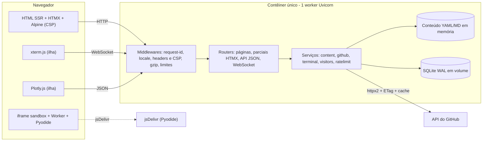
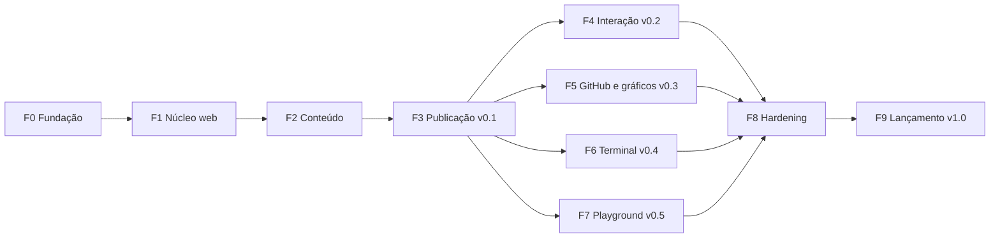

# Plano de implementação — Hub web interativo (currículo em Python)

> **Status:** proposta v1.0 · **Data:** 2026-10-29
> **Base:** [requirements.txt](./requirements.txt) e [requirements-dev.txt](./requirements-dev.txt) — instalação e testes de fumaça verificados em Windows + Python 3.14.
> **Legenda:** **(verificado)** = testado durante a preparação deste plano; **(spike)** = risco conhecido, com experimento de validação previsto no cronograma.

**Conteúdo:** 1 Visão e metas · 2 Escopo e releases · 3 Features e habilidades · 4 Decisões de arquitetura · 5 Arquitetura e repositório · 6 Dados e contratos · 7 Plano por fases · 8 Qualidade · 9 Operação e deploy · 10 Riscos · 11 Cronograma e definição de pronto · 12 Suas pendências · Apêndice A

---

## 1. Visão e metas

**Objetivo.** Um site-currículo em que cada seção é uma demonstração técnica. Em vez de listar "FastAPI, asyncio, SQLAlchemy, testes", o visitante *usa* um site feito com isso — navega, conversa com um terminal no navegador, roda Python no navegador — e pode ler o código, o CI e a cobertura (repositório público).

**Público.** Recrutadores (precisam do essencial em 2–3 minutos e de um PDF) e tech leads/pares (querem ver decisões, código e qualidade).

**Princípios**

1. **Mostrar, não contar** — toda feature interativa evidencia uma habilidade (§3).
2. **Conteúdo primeiro** — funciona sem JavaScript (SSR); o JS só melhora a experiência.
3. **Seguro por padrão** — nenhum código do visitante roda no servidor; CSP sem `unsafe-eval`; sem painel admin web.
4. **Rápido e acessível** — orçamentos de peso (§8.3) e WCAG 2.2 AA.
5. **Operação simples** — 1 contêiner, 1 processo, 1 arquivo SQLite.
6. **Conteúdo separado do código** — YAML/Markdown, em pt-BR e en.

**Metas da v1.0**

- Lighthouse (mobile) ≥ 95 em Desempenho, Acessibilidade, Boas práticas e SEO nas páginas sem Plotly/Pyodide; ≥ 90 nas demais.
- 0 violações de CSP no console e 0 violações críticas/sérias no axe-core, em pt/en e nos temas claro/escuro.
- Cobertura de testes ≥ 85% (branch); `mypy --strict`, ruff e djlint sem avisos; `pip-audit` limpo.
- CI verde em Linux e Windows, Python 3.11–3.14; paridade pt/en validada em CI.
- Publicado em HTTPS, com backup/restore e rollback ensaiados.

---

## 2. Escopo e releases

| Release | Entrega | Fases |
|---|---|---|
| **v0.1 (MVP)** | Home, Experiência, Projetos e estudos de caso, Skills, Currículo (impressão + PDF), pt/en, tema claro/escuro, API JSON somente leitura, publicado em HTTPS | F0–F3 |
| v0.2 | Contato, livro de visitas, endossos de skills, moderação por CLI | F4 |
| v0.3 | Dados ao vivo do GitHub e gráficos Plotly | F5 |
| v0.4 | Terminal web (xterm.js + WebSocket + Rich) | F6 |
| v0.5 | Playground Python no navegador (Pyodide) | F7 |
| **v1.0** | Hardening, acessibilidade/performance, documentação e lançamento | F8–F9 |

**Linha de corte.** F0–F5 já formam um portfólio completo. Se o prazo apertar, corte a F7 e depois a F6 (o terminal demonstra mais Python de servidor do que o playground).

**Fora de escopo:** login/painel admin web; blog/RSS; comentários de terceiros; analytics e trackers de terceiros; execução de código do visitante no servidor; Postgres/Redis (caminho de escala na §9); SPA, bundler e Node.

---

## 3. Features e habilidades demonstradas

| Feature | Habilidades Python evidenciadas |
|---|---|
| Núcleo SSR | FastAPI (injeção de dependências, lifespan, middlewares), async/await, Pydantic v2, type hints estritos |
| Conteúdo | Validação com Pydantic, pipelines YAML/Markdown, `pathlib`, geração de CSS (Pygments) |
| Persistência | SQLAlchemy 2.1 async (`Mapped`), Alembic, transações e constraints, SQLite em WAL |
| GitHub ao vivo | `httpx2` assíncrono, ETag/requisições condicionais, cache TTL, single-flight, degradação graciosa |
| Terminal | WebSocket, `asyncio`, padrão Command com registro por decoradores, Rich, `shlex`/`difflib` |
| Playground | Python no navegador (Pyodide/WASM), isolamento por sandbox |
| CLI | Typer + Rich (admin, build, export, moderação) |
| Gráficos | Plotly construído em Python (figuras servidas como JSON) |
| Qualidade | pytest (async, parametrização, hypothesis), mypy strict, ruff, cobertura, CI em matriz |
| Entrega | Docker multi-stage, 12-factor (pydantic-settings), healthchecks, backups |

Esta tabela também alimenta a página "Sobre o site" (F2/F8).

---

## 4. Decisões de arquitetura

| # | Decisão | Justificativa e evidência |
|---|---|---|
| D1 | Monólito modular SSR: FastAPI + Jinja2 + HTMX, sem SPA e sem Node | Simplicidade, SEO e funcionamento sem JS; o Python é o protagonista (em vez de React/Next) |
| D2 | Navegação por `hx-boost` e parciais com `jinja2-fragments` | **(verificado)** `TemplateResponse(..., block_names=["title_tag", "content"])` renderiza só esses blocos; eles precisam estar definidos no template filho (blocos só do pai dão `KeyError`) |
| D3 | Alpine.js **build CSP** (`@alpinejs/csp` 3.17.5) + htmx com `allowEval=false` | **(verificado)** no Chromium com `script-src 'self'; style-src 'self'`: `x-data` inline, `@click="n++"`, ternário e atribuição funcionam; htmx troca fragmentos e atualiza `<title>`; 0 violações. O Alpine padrão exigiria `unsafe-eval` |
| D4 | CSP **por perfil**: estrita por padrão; `style-src 'unsafe-inline'` só nas páginas com Plotly e xterm | **(verificado)** Plotly (plotly.js v4.1.1 do wheel) e xterm 6.0.0 injetam `<style>`: sem a relaxação, o modebar do Plotly fica sem estilo e o texto do terminal fica invisível. `script-src` continua `'self'` em todos os perfis |
| D5 | Assets vendorizados (htmx, Alpine CSP, xterm) com `assets.lock.json` (URL + SHA-384); **sem CDN em runtime**. Só o Pyodide vem do jsDelivr, dentro do iframe sandbox | `script-src 'self'` sem allowlist de CDN (jsDelivr serve qualquer pacote npm), sem vazar IP do visitante para terceiros e testes herméticos. O cabeçalho do `requirements.txt` já reflete esta decisão |
| D6 | Tailwind v4 via `pytailwindcss` (binário standalone v4.3.3) | **(verificado)** `@plugin "@tailwindcss/typography"`, `@source`, `@theme` e `@custom-variant dark` funcionam no standalone; o binário tem ≈ 112 MB (cachear no CI e no Docker). Em vez de Node + PostCSS |
| D7 | Conteúdo em YAML/Markdown validado por Pydantic e imutável em memória; banco só para dados dinâmicos | Edição por PR, falha rápida no startup, nenhuma consulta para ler texto |
| D8 | SQLite (WAL) + SQLAlchemy async + Alembic, **instância única (1 worker)** | Dados pequenos; `limits` e `cachetools` em memória pressupõem um processo. Postgres/Redis ficam como caminho de escala |
| D9 | Sem painel admin: moderação por CLI (Typer + Rich) | Zero superfície de autenticação |
| D10 | i18n com gettext/Babel, **um `Jinja2Blocks` por locale** e URLs `/pt` e `/en` | **(verificado)** `install_gettext_translations(newstyle=True)` + blocos + `` funcionam; `pybabel extract/init/compile` extrai templates Jinja e `.py`. A URL é a fonte da verdade (sem cookie de idioma) |
| D11 | Terminal = comandos virtuais (funções puras registradas); sem shell, `subprocess`, `eval` ou sistema de arquivos real | Nenhuma execução de código no servidor |
| D12 | Playground: iframe `sandbox` (origem opaca) + Web Worker + Pyodide 314.0.7 | Código do visitante nunca toca o servidor nem a origem do site; timeout por `worker.terminate()`; CSP estrita do site intacta |
| D13 | Rate limit com `limits` (async, janela móvel, memória) via dependência FastAPI; HTTP com `httpx2` e `httpx2.MockTransport` nos testes | **(verificado)** `slowapi` emite `DeprecationWarning` no Python 3.14; o Starlette 1.10 marca `httpx` como obsoleto no `TestClient` |
| D14 | Datas em UTC; sem fusos nomeados | **(verificado)** `ZoneInfo("America/Sao_Paulo")` falha no Windows sem `tzdata`. Se for preciso: `tzdata==2026.6` |
| D15 | Pacote plano `app/`; `pyproject.toml` só com `[tool.*]`; tarefas via `python -m app` (Typer), sem Makefile | Windows/PowerShell nativo |
| D16 | PDF e imagem OG gerados no CI com Playwright (dev-only), nunca no runtime | O Chromium não entra na imagem de produção |

---

## 5. Arquitetura e repositório

### 5.1 Visão geral



### 5.2 Fluxo de uma navegação (HTMX)

1. `GET /pt/projects` → middlewares definem locale, request-id e cabeçalhos de segurança.
2. O router devolve a página **completa** se não houver `HX-Request` **ou** se houver `HX-History-Restore-Request`; caso contrário devolve só o **fragmento** (`title_tag` + `content`). **(verificado)** no htmx 2.0.11: na restauração de histórico o cliente envia `HX-Request: true` *e* `HX-History-Restore-Request: true`, e o servidor deve responder com a página inteira.
3. Respostas que variam por esses cabeçalhos levam `Vary: HX-Request, HX-History-Restore-Request`.
4. O `<title>` vai no início do fragmento: o htmx 2 atualiza `document.title` e remove o elemento **(verificado)**.
5. Por padrão o htmx **não** troca respostas 4xx/5xx **(verificado)**; `responseHandling` é configurado para trocar 422 (validação) e 429 (limite) por fragmentos amigáveis.
6. Nenhum `<script>` em fragmentos. Código pesado entra por **ilhas** (`data-island="terminal"`, `"plotly"`…), carregadas com `import()` sob demanda em `htmx:load`.

### 5.3 Estrutura do repositório

```text
myself/
├─ PLANO_DE_IMPLEMENTACAO.md
├─ requirements.txt · requirements-dev.txt
├─ pyproject.toml            # só [tool.*]: ruff, mypy, pytest, coverage, djlint
├─ assets.lock.json          # URL + SHA-384 dos assets vendorizados
├─ alembic.ini · babel.cfg · Dockerfile · compose.yaml · .env.example
├─ .pre-commit-config.yaml · .github/workflows/ · .github/dependabot.yml
├─ app/
│  ├─ __main__.py            # python -m app  ->  CLI Typer
│  ├─ main.py                # create_app(), lifespan
│  ├─ cli/                   # dev, serve, assets, content, db, moderation, i18n, export, github
│  ├─ core/                  # config, logging, security (CSP/headers), ratelimit, visitors, htmx, i18n
│  ├─ content/               # models, loader, markdown, store
│  ├─ db/                    # engine, models, repositories, migrations/ (Alembic)
│  ├─ services/              # github, guestbook, endorsements, contact, charts
│  ├─ terminal/              # protocol, registry, commands/, render, session
│  ├─ routers/               # pages, api, guestbook, contact, endorsements, terminal, playground, seo, health
│  ├─ locales/               # pt_BR/ e en/ (LC_MESSAGES/messages.po)
│  └─ web/
│     ├─ templates/          # base.html, pages/, partials/, components/, errors/
│     └─ static/             # src/app.css, js/ (app.js, islands/), img/ · dist/ e vendor/ (gerados)
├─ content/
│  ├─ pt/                    # profile.yaml, experience.yaml, skills.yaml, education.yaml, projects/*.md
│  ├─ en/                    # mesma estrutura (paridade validada)
│  └─ demos/                 # *.py + demos.yaml (playground)
├─ tests/                    # unit/, integration/, e2e/, conftest.py
├─ docs/adr/                 # decisões arquiteturais (a partir da F8)
└─ README.md · LICENSE · CHANGELOG.md
```

---

## 6. Dados e contratos

### 6.1 Tabelas (SQLite)

| Tabela | Campos principais | Restrições e índices |
|---|---|---|
| `guestbook_entries` | `id`, `name` (≤ 60), `message` (≤ 500), `locale`, `status` (pending/approved/rejected), `visitor_hash`, `created_at`, `moderated_at` | `CHECK` de tamanhos; índice (`status`, `created_at`) |
| `endorsements` | `id`, `skill_slug` (≤ 64), `visitor_hash`, `created_at` | `UNIQUE` (`skill_slug`, `visitor_hash`); índice em `skill_slug` |
| `contact_messages` | `id`, `name`, `email`, `subject` (≤ 120), `message` (≤ 2000), `locale`, `status` (new/read/replied/spam), `visitor_hash`, `created_at`, `notified_at` | índice (`status`, `created_at`) |

`skill_slug` referencia o conteúdo YAML (sem FK) e é validado contra o `ContentStore` na escrita. Datas em UTC. **Nenhum IP é persistido.**

### 6.2 Rotas

| Rota | Descrição | Resposta |
|---|---|---|
| `GET /` | Redireciona para `/{lang}/` (negociação por `Accept-Language` com `babel.core.negotiate_locale`) | 302 |
| `GET /{lang}/` | Home | página ou fragmento |
| `GET /{lang}/experience` (`?tech=`) | Linha do tempo com filtro | página ou fragmento |
| `GET /{lang}/projects` (`?q=&tag=`) | Grade filtrável | página ou fragmento |
| `GET /{lang}/projects/{slug}` | Estudo de caso | página ou fragmento |
| `GET /{lang}/projects/{slug}/github` | Cartão com métricas ao vivo (preguiçoso, `hx-trigger="revealed"`) | fragmento |
| `GET /{lang}/skills` | Skills, gráficos e endossos | página ou fragmento |
| `GET /{lang}/skills/chart.json` | Figura Plotly | JSON |
| `POST` e `DELETE /{lang}/skills/{slug}/endorse` | Endossar/retirar (idempotente) | fragmento (contador) |
| `GET` e `POST /{lang}/guestbook` | Listar/enviar | página ou fragmento |
| `GET` e `POST /{lang}/contact` | Formulário de contato | página ou fragmento |
| `GET /{lang}/terminal` e `WS /ws/terminal` | Terminal | página · WebSocket |
| `GET /{lang}/playground` e `GET /playground/frame` | Página e documento sandbox (CSP própria) | HTML |
| `GET /{lang}/resume` e `GET /downloads/resume.{lang}.pdf` | Currículo imprimível e PDF | HTML · PDF |
| `GET /{lang}/about-site` e `GET /{lang}/privacy` | Sobre o site; privacidade | páginas |
| `GET /api/v1/profile`, `/skills`, `/experience`, `/projects` (`?lang=`) | API somente leitura | JSON |
| `GET /api/docs` | OpenAPI (perfil CSP próprio, ver §8.2) | HTML |
| `GET /healthz` e `GET /readyz` | Probes (processo; conteúdo + banco) | JSON |
| `GET /sitemap.xml`, `/robots.txt`, `/.well-known/security.txt` | SEO e segurança | texto |
| `POST /csp-report` | Relatórios de CSP (F8; só log, com limite) | 204 |

### 6.3 Configuração (`pydantic-settings`, prefixo `HUB_`)

| Variável | Uso |
|---|---|
| `HUB_ENV` | `dev`, `test` ou `prod` |
| `HUB_SECRET_KEY` | Obrigatória em prod (≥ 32 bytes, `SecretStr`); assina cookies e deriva `visitor_hash` |
| `HUB_SITE_URL` | URL canônica, OG, allowlist de `Origin` do WebSocket |
| `HUB_DATABASE_URL` | Padrão `sqlite+aiosqlite:///./data/hub.db` |
| `HUB_CONTENT_DIR`, `HUB_DEFAULT_LOCALE` | Pasta do conteúdo e idioma padrão (`pt`) |
| `HUB_GITHUB_USER`, `HUB_GITHUB_TOKEN`, `HUB_GITHUB_OFFLINE` | Usuário, token opcional (PAT sem escopos extras) e modo offline (usa o snapshot) |
| `HUB_NOTIFY_WEBHOOK_URL` | Webhook opcional de novos contatos/mensagens |
| `HUB_TRUSTED_PROXIES`, `HUB_COOKIE_SECURE` | IPs de proxy confiáveis; `Secure` nos cookies |
| `HUB_LOG_LEVEL`, `HUB_LOG_FORMAT` | `rich` em dev, `json` em prod |

---

## 7. Plano por fases

> Estimativas em dias úteis de trabalho focado, para 1 pessoa com apoio de IA (±30%). Cada fase termina com código testado, CI verde e, nos marcos de release, deploy.

### F0 — Fundação do repositório e da toolchain · 0,5–1 dia

**Objetivo:** esqueleto executável e verde no CI desde o primeiro commit.

- [ ] `git init`; `.gitignore` (venv, `.env`, `data/`, `app/web/static/dist/`, `app/web/static/vendor/`, caches); `.gitattributes` (`* text=auto eol=lf`); `.editorconfig`; `LICENSE` (MIT); README mínimo. Repositório **público** no GitHub desde o início (ele faz parte do currículo).
- [ ] Ambiente: Python 3.14 em dev e prod; piso **3.11** (exigido por SQLAlchemy 2.1, pydantic-settings 2.16, hypothesis, pre-commit e pytailwindcss). Se o `pip` falhar com `ConnectionResetError` em wheels grandes (observado com o Playwright, ≈ 39 MB), usar `--retries 10 --timeout 120` ou baixar o wheel com `curl -C -`.
- [ ] `pyproject.toml` (só `[tool.*]`):
  - ruff: `target-version = "py311"`, `line-length = 100`, regras `E,F,W,I,N,UP,B,A,C4,DTZ,T20,SIM,PT,RET,ARG,PTH,PERF,RUF,ASYNC,S,FAST,TC,LOG,G` (seletores aceitos pelo ruff 0.17.3 — **verificado**);
  - mypy: `strict = true`, plugin `pydantic.mypy`, `ignore_missing_imports` para `plotly.*` (sem tipagem — **verificado**); stubs necessários: `types-PyYAML` e `types-Pygments` (o `cachetools` já traz `py.typed`);
  - pytest: `asyncio_mode = "auto"`, `asyncio_default_fixture_loop_scope = "function"` (evita o aviso **verificado**), `--strict-markers`, markers `e2e` e `slow`, warnings como erro (com allowlist justificada);
  - coverage: `branch = true`, `fail_under = 85`.
- [ ] `.pre-commit-config.yaml`: ruff (check + format), djlint (perfil Jinja), hooks básicos (yaml, EOF, espaços, arquivos grandes, chaves privadas) e mypy local.
- [ ] Esqueleto: `app/main.py` (`create_app()` + `/healthz`), `app/__main__.py` (Typer com `dev` e `serve`) e 1 teste de integração.
- [ ] CI (GitHub Actions) **desde já**: lint, mypy e pytest em **ubuntu e windows** × Python **3.11–3.14**; cache do pip; `pip-audit` no ambiente instalado após `pip install -U pip` (o pip 25.2 empacotado tem CVEs conhecidos — **verificado**); Dependabot semanal (pip e github-actions). Isso valida cedo o que só foi testado em Windows/3.14. Já está **verificado** que as extensões nativas do runtime (uvloop, httptools, watchfiles, greenlet, pydantic-core, MarkupSafe, PyYAML) têm wheels `cp314` manylinux para x86_64 e aarch64.
- [ ] Fluxo: trunk-based com PRs curtos, Conventional Commits, tags SemVer.
- [ ] Comandos-alvo do dia a dia (PowerShell):

  ```powershell
  python -m venv .venv; .\.venv\Scripts\Activate.ps1
  python -m pip install -U pip; pip install -r requirements-dev.txt; playwright install chromium
  python -m app assets sync; python -m app assets build   # F1
  python -m app dev                                       # Uvicorn --reload + Tailwind --watch
  pytest; pytest tests/e2e
  ruff check .; ruff format --check .; djlint app/web/templates --check; mypy app
  ```

**Aceite:** `pytest` e `pre-commit run -a` verdes local e na matriz do CI; `python -m app dev` sobe e `/healthz` responde 200.

### F1 — Núcleo web, design system e pipeline de assets · 2–3 dias

**Objetivo:** a "casca" do site — layout, i18n, HTMX, CSP, assets — com uma página de exemplo bilíngue.

- [ ] **Config e ciclo de vida:** `Settings` (§6.3), `.env.example`, `create_app()` com lifespan (conteúdo, cliente HTTP, engine), logging (JSON em prod, Rich em dev) com request-id e sem PII, páginas de erro localizadas (404/500) e respostas de erro cientes de HTMX.
- [ ] **Middlewares:** locale (prefixo da URL → `request.state.locale`), cabeçalhos de segurança + CSP por perfil (§8.2), GZip (≥ 500 bytes), limite de corpo (16 KB para formulários), `Cache-Control` (estáticos com hash `immutable`; HTML `no-cache`).
- [ ] **Templates:** `base.html` (skip link, landmarks, navegação, troca de idioma e tema, rodapé), macros em `components/`. Convenção: toda página define os blocos `title_tag` e `content`; um `Jinja2Blocks` por locale (D2, D10).
- [ ] **HTMX:** `hx-boost` no `<body>` com `hx-target="#main"` e `hx-swap="innerHTML show:window:top"`; regra de resposta completa × fragmento e `Vary` (§5.2); `<meta name="htmx-config">` com `allowEval=false`, `includeIndicatorStyles=false` e `responseHandling` que troca 422/429; estilo do indicador no nosso CSS.
- [ ] **Alpine CSP** (`@alpinejs/csp` 3.17.5) para interações locais (menu, tema, abas). Sem `eval`.
- [ ] **Tailwind v4:** `app/web/static/src/app.css` com `@import "tailwindcss"`, `@plugin "@tailwindcss/typography"`, `@source`, `@theme` (tokens) e `@custom-variant dark`; `assets build/watch` com fingerprint (hash no nome + manifest) e helper `static_url()`. Fixar `TAILWINDCSS_VERSION=v4.3.3` e cachear o binário.
- [ ] **Vendorização:** `assets sync` baixa htmx 2.0.11, `@alpinejs/csp` 3.17.5, `@xterm/xterm` 6.0.0 e `@xterm/addon-fit` 0.11.0, confere o SHA-384 em `assets.lock.json` e grava em `static/vendor/`; copia o `plotly.min.js` do wheel (confere a versão).
- [ ] **i18n:** `babel.cfg` (`[python: app/**.py]`, `[jinja2: app/web/templates/**.html]` com `jinja2.ext.i18n`), `python -m app i18n extract/update/compile` (envolve `pybabel`), catálogos pt_BR e en, `Accept-Language` em `/`.
- [ ] **Tema:** `prefers-color-scheme` + alternância persistida em `localStorage`, sem flash (script externo pequeno no `<head>`, nunca inline).
- [ ] **Tipografia:** pilha de fontes do sistema (sem webfonts: desempenho e privacidade).
- [ ] **Testes:** headers (CSP, `Vary`, `nosniff`…), completo × fragmento × history-restore, locale, manifest de assets; primeiro E2E (navegar, voltar/avançar, trocar idioma) que **falha em qualquer erro de console ou violação de CSP**.

**Aceite:** página bilíngue SSR; navegação `hx-boost` troca só `#main` e atualiza o título; voltar/avançar funciona; `assets build` idempotente; 0 violações de CSP; Lighthouse ≥ 95 na página base.

### F2 — Conteúdo e páginas do currículo · 3–4 dias (+ trilha de conteúdo)

**Objetivo:** todo o conteúdo do currículo servido em pt/en, com SEO e API.

- [ ] **Modelos Pydantic:** `Profile`, `Link`, `Experience`, `SkillCategory`/`Skill` (`slug`, `level` 1–5, `years`, `tags`, `evidence` = slugs de projetos), `Education`, `Project`, `Demo`.
- [ ] **Loader e validação:** `yaml.safe_load` (sempre `safe_load`) + Markdown com frontmatter; carregado no startup (falha rápida) e `python -m app content validate` (slugs únicos, referências cruzadas skill↔projeto, links http/https, paridade pt↔en de slugs e campos numéricos/datas).
- [ ] **Markdown:** `MarkdownIt("commonmark", {"html": False}).enable(["table", "strikethrough"])` **(verificado)**; Pygments com classes CSS (estilos claro/escuro gerados no `assets build`); tempo de leitura; âncoras de título.
- [ ] **Páginas:** Home; Experiência (timeline + filtro por tecnologia com `hx-get` e `hx-push-url`); Projetos (grade com busca/filtro) e estudo de caso; Skills (agrupadas, com evidências); Formação; Currículo (`/resume`, CSS de impressão); Sobre o site; 404.
- [ ] **Sem JS:** filtros são formulários `GET` com a mesma URL; HTMX só melhora.
- [ ] **SEO:** `<title>` e description por página, canonical, Open Graph/Twitter, `hreflang`, JSON-LD `Person`, `sitemap.xml`, `robots.txt`, `security.txt`.
- [ ] **API somente leitura** `/api/v1/*` com `response_model` Pydantic e `?lang=`; docs em `/api/docs` com perfil CSP próprio **(spike)**: o Swagger do FastAPI usa scripts externos/inline — decidir entre perfil isolado com jsDelivr ou Swagger UI vendorizado com página própria.
- [ ] **Teste de crawl:** percorre o sitemap em pt/en (`TestClient`) → 200, sem links internos quebrados, um `<h1>`, `lang` correto.

Formato do conteúdo (exemplo):

```yaml
# content/pt/skills.yaml
- category: Backend
  skills:
    - slug: fastapi
      name: FastAPI
      level: 5                         # 1 a 5
      years: 4
      tags: [async, api]
      evidence: [hub-curriculo]        # slugs de projetos
```

```markdown
---
# content/pt/projects/hub-curriculo.md
title: Hub-currículo interativo
summary: Este site, construído para demonstrar Python.
repo: seu-usuario/seu-repo
skills: [fastapi, htmx, sqlalchemy]
featured: true
order: 1
---
## Problema
...
```

**Aceite:** `content validate` passa; todas as páginas pt/en servem SSR e fragmento; navegação e filtros funcionam sem JS; landmarks e foco visível corretos.

### F3 — Contêiner, CI/CD e primeira publicação (v0.1) · 2–3 dias

**Objetivo:** MVP no ar em HTTPS, com pipeline repetível.

- [ ] **Dockerfile multi-stage** (`python:3.14-slim`, multi-arch — tag **verificada**): estágio *builder* instala `requirements.txt` + `pytailwindcss` e roda `assets sync/build` (o binário de ≈ 112 MB fica só aqui); estágio final instala apenas `requirements.txt`, roda como **usuário não-root**, `PYTHONUNBUFFERED=1`, `HEALTHCHECK` via `urllib`, volume `/data`. Sem compilador (wheels `cp314` existem). Registrar o tamanho da imagem (meta orientativa < 300 MB).
- [ ] **Servidor:** `python -m app serve` → Uvicorn com **1 worker**, `proxy_headers=True`, `forwarded_allow_ips` restrito ao proxy, `server_header=False`, `ws_max_size` reduzido, `timeout_keep_alive` curto. Migrações antes de subir (`db upgrade`, a partir da F4).
- [ ] `compose.yaml` para rodar "como em produção" localmente.
- [ ] **Artefatos de build no CI:** job com Playwright gera `resume.pt.pdf`, `resume.en.pdf` (`page.pdf()` sobre `/resume` com CSS de impressão) e `og.png`; o job da imagem os copia. Localmente: `python -m app export pdf` e `export og`.
- [ ] **Pipeline:** lint → mypy → testes (matriz) → E2E → build da imagem → push no GHCR (main/tags) → deploy. Segredos só em *secrets* do CI/provedor.
- [ ] **Hospedagem** (decisão D-1): exige **volume persistente** para o SQLite e processo único. Opções: VPS + Docker + Caddy (HTTPS automático) ou PaaS com volume (ex.: Fly.io). Evitar disco efêmero.
- [ ] **Domínio e TLS:** domínio próprio, redirecionamento www/apex, HSTS depois de validar.
- [ ] **Observabilidade mínima:** logs JSON, `/healthz` (processo), `/readyz` (conteúdo + banco), monitor externo de uptime.
- [ ] **Release:** tag `v0.1.0`, `CHANGELOG.md` (Keep a Changelog), rollback = redeploy da tag anterior.

**Aceite:** URL pública em HTTPS; `curl -I` mostra os cabeçalhos de segurança; PDF baixável; pipeline verde de ponta a ponta; rollback ensaiado.

### F4 — Persistência e interação (v0.2): contato, livro de visitas, endossos · 3–4 dias

**Objetivo:** primeiras escritas no servidor, com defesa contra abuso.

- [ ] **Banco:** engine async (`sqlite+aiosqlite`), PRAGMAs por conexão (`journal_mode=WAL`, `foreign_keys=ON`, `synchronous=NORMAL`, `busy_timeout`), `naming_convention` de constraints, sessão por requisição via dependência.
- [ ] **Alembic** (template async), migração inicial, `python -m app db upgrade/backup/purge`. `backup` usa `sqlite3.Connection.backup()` (stdlib). `alembic check` no CI (modelo sem drift).
- [ ] **Identidade do visitante:** cookie `hub_vid` assinado (HMAC-SHA256 da stdlib, `hmac.compare_digest`), **emitido só em ações de escrita**; `visitor_hash = HMAC(secret, id)`; o IP vive só em memória (chave do rate limit).
- [ ] **Rate limit:** dependência `rate_limit(bucket, "3/hour")` sobre `limits.aio` (janela móvel + memória) → 429 com `Retry-After`. Valores iniciais: contato 3/h, livro 3/h, endosso 30/h, API 60/min, global 300/min por IP.
- [ ] **Anti-spam:** honeypot, timestamp assinado (aceita entre 3 s e 2 h), corpo ≤ 16 KB, rejeitar URLs no livro de visitas, validação Pydantic (`EmailStr`), checagem de `Origin`/`Sec-Fetch-Site` same-origin em `POST`/`DELETE`.
- [ ] **Livro de visitas:** lista de aprovados (paginação por cursor) e formulário HTMX; novas entradas nascem `pending`. CLI `python -m app moderation list/approve/reject/delete` (tabelas Rich).
- [ ] **Endossos:** `POST`/`DELETE` idempotentes (`UNIQUE`); contagens agregadas com cache curto.
- [ ] **Contato:** grava em `contact_messages`; notificação opcional por webhook (`httpx2`, timeout curto, falha só gera log); sucesso/erro como fragmento.
- [ ] **Privacidade:** página `/privacy` (dados coletados, finalidade, retenção — mensagens de contato 12 meses via `db purge` —, cookie funcional, ausência de trackers). Avaliar obrigações da LGPD (não é aconselhamento jurídico).

**Aceite:** formulários funcionam com e sem JS; o 4º envio na janela retorna 429 amigável; honeypot/timestamp barram bots; `alembic upgrade head` em banco vazio e `alembic check` limpos; teste de concorrência (50 endossos simultâneos do mesmo visitante → 1 linha); nenhum dado pessoal nos logs.

### F5 — GitHub ao vivo e visualizações (v0.3) · 3 dias

**Objetivo:** projetos e skills "vivos" e visuais, sem depender do GitHub para renderizar.

- [ ] **`GitHubClient`** (`httpx2.AsyncClient` único no lifespan): `base_url=https://api.github.com`, `Accept: application/vnd.github+json`, `X-GitHub-Api-Version` fixado (a documentação lista `2026-03-10`; sem o cabeçalho vale `2022-11-28`), `User-Agent`, token opcional, timeouts curtos, *retry* com backoff só para 5xx/timeout, respeito a `retry-after` e `x-ratelimit-reset`, requisições **seriais** (limites secundários).
- [ ] **Cache:** `TTLCache` (30 min) + ETag/`If-None-Match` + *single-flight* por chave + *stale-while-error* + snapshot em disco (`data/github_snapshot.json`) para cold start/offline. Limites **(verificado na documentação)**: 60 req/h sem token, 5.000 req/h com token; um `304` só deixa de contar na cota quando a requisição está autenticada — por isso usar `HUB_GITHUB_TOKEN`.
- [ ] **Projetos** declaram `repo: owner/name` no YAML e são enriquecidos (estrelas, linguagem, último push). O cartão carrega de forma preguiçosa (`hx-trigger="revealed"`) e nunca bloqueia a página.
- [ ] **Linguagens:** `/repos/{owner}/{repo}/languages` → donut Plotly por projeto e agregado.
- [ ] **Skills:** radar/barras por categoria com contagem de endossos; figuras montadas em Python (`plotly.graph_objects`), servidas em JSON e desenhadas por uma ilha que carrega `plotly.min.js` sob demanda (≈ 4,7 MB bruto, 1,46 MB gzip — **verificado**). Perfil CSP `charts`.
- [ ] **Acessibilidade dos gráficos:** tabela equivalente em `<details>`, paleta segura para daltonismo, `prefers-reduced-motion`.
- [ ] `GET /api/v1/github/repos` (cacheado).

**Aceite:** com o GitHub fora do ar ou cota esgotada o site continua completo (snapshot); testes com `httpx2.MockTransport` cobrem 200, ETag/304, 403 de rate limit, timeout, *stale* e *single-flight*; gráfico renderiza sem violações no perfil `charts`.

### F6 — Terminal web (v0.4) · 3–4 dias

**Objetivo:** um terminal no navegador que navega pelo currículo — vitrine de Python assíncrono.

- [ ] **Protocolo JSON** sobre WebSocket, validado com Pydantic (união discriminada): cliente→servidor `line`, `complete`, `resize`; servidor→cliente `out` (ANSI), `prompt`, `complete`, `navigate`, `error`.
- [ ] **Comandos** registrados por decorador (`@command("skills", aliases=[...], help=...)`), funções puras `(ctx, args) -> RenderableType` (Rich): `help, about, skills, experience, projects, project <slug>, contact, lang, theme, open <seção>, clear, whoami, history`; `ls`/`cat` num FS virtual (opcional); sugestão com `difflib.get_close_matches`; `shlex.split` com erros de aspas tratados.
- [ ] **Renderização:** `Console(file=StringIO(), force_terminal=True, color_system="truecolor", width=cols)` → ANSI; normalizar `\n` → `\r\n`; largura vinda de `resize`.
- [ ] **Limites:** frame ≤ 1 KB, linha ≤ 256 caracteres, ≤ 20 mensagens por 10 s por conexão, ociosidade de 5 min, ≤ 5 conexões por IP e ≤ 100 globais, allowlist de `Origin` (WebSocket não tem CORS), handshake com rate limit.
- [ ] **Cliente:** xterm.js 6.0.0 + addon-fit (globais `Terminal` e `FitAddon.FitAddon` no bundle UMD — **verificado**); editor de linha mínimo (inserir/apagar, ←/→, Home/End, ↑/↓ histórico, Tab → `complete`, Ctrl+C, Ctrl+L); reconexão com backoff; `<input>` alternativo para mobile e leitor de tela (`screenReaderMode`); link "versão sem terminal".
- [ ] **CSP `terminal`:** `style-src 'self' 'unsafe-inline'` (**verificado**: sem isso o texto não aparece) e `connect-src` com `wss://<host>` explícito **(spike)**: confirmar o comportamento de `'self'` para `wss:` no Safari.

**Aceite:** testes de WebSocket (`TestClient.websocket_connect`) para cada comando, limite e erro; property tests (hypothesis): nenhuma entrada gera exceção nem saída acima do limite; E2E digita `help` e `skills` e vê a saída; nenhum uso de `subprocess`/`eval` (regras `S` do ruff).

### F7 — Playground Python no navegador (v0.5) · 3–4 dias

**Objetivo:** executar Python no navegador do visitante, com isolamento forte.

- [ ] **Spike inicial (0,5–1 dia):** Pyodide 314.0.7 (Python 3.14.2 — **verificado**) num Worker dentro de iframe `sandbox="allow-scripts"` (origem opaca), servido por `/playground/frame` com CSP própria: `sandbox allow-scripts; default-src 'none'; script-src 'self' 'wasm-unsafe-eval' https://cdn.jsdelivr.net; connect-src https://cdn.jsdelivr.net; worker-src blob:; frame-ancestors 'self'`. Critérios de saída: roda `print(sum(range(10)))`; interrompe `while True: pass` em ≤ 10 s via `worker.terminate()`; nenhum acesso à origem do site. **Plano B:** Worker same-origin, **sem** execução automática e com CSP dedicada.
- [ ] **Protocolo `postMessage`** com esquema validado e checagem de `event.source`; saída (stdout/stderr) em lotes; timeout de 10 s; botões Parar/Reiniciar; limites de tamanho de entrada e saída.
- [ ] **Demos** em `content/demos/*.py` + `demos.yaml` (slug, título, descrição, tags, skills); código exibido com Pygments e editável em `<textarea>`; **sem código na URL e sem execução automática** (evita XSS por link) — só o slug da demo.
- [ ] **Carregamento sob demanda:** botão "Carregar Python (≈ 6 MB)" — `pyodide.asm.wasm` 3,4 MB + `python_stdlib.zip` 2,5 MB com brotli (**verificado**); progresso e cache HTTP. Pacotes disponíveis no lock (**verificado**): numpy, pandas, pydantic, pyyaml, rich, micropip…; `plotly` e `hypothesis` **não** estão — as demos usam stdlib, pydantic ou numpy.
- [ ] **CI executa cada demo no CPython** (timeout + saída esperada): só entra código que funciona.

**Aceite:** E2E executa uma demo, testa timeout e erro de sintaxe; nada do Pyodide carrega sem ação explícita; a requisição ao jsDelivr só ocorre após o clique e está descrita em `/privacy`.

### F8 — Hardening, qualidade e documentação (v1.0-rc) · 3 dias

- [ ] **CSP e cabeçalhos:** auditar os perfis; `Content-Security-Policy-Report-Only` + `POST /csp-report` por 1–2 semanas antes de endurecer; `Referrer-Policy: strict-origin-when-cross-origin`, `X-Content-Type-Options: nosniff`, `Permissions-Policy` (câmera, microfone e geolocalização desativados), `Cross-Origin-Opener-Policy: same-origin`, HSTS em prod. **Não** usar `Cross-Origin-Resource-Policy: same-origin`: bloquearia os recursos do iframe sandbox (origem opaca).
- [ ] **Acessibilidade:** axe-core injetado via Playwright (sem dependência nova) em todas as páginas (pt/en, claro/escuro); teste manual de teclado e leitor de tela (NVDA); contraste AA; foco após troca HTMX.
- [ ] **Performance:** Lighthouse nos 4 tipos de página; orçamentos da §8.3; `Cache-Control` imutável nos assets com hash; imagens WebP/AVIF com `width`/`height` e `loading="lazy"`.
- [ ] **Segurança:** revisão com checklist (OWASP ASVS nível 1 como guia); fuzz com hypothesis em formulários e WebSocket; `pip-audit`/Dependabot em dia; ZAP baseline (opcional); `security.txt` com validade.
- [ ] **Resiliência:** testes de falha (GitHub fora, banco bloqueado, WebSocket cai, Pyodide não carrega) com mensagens amigáveis.
- [ ] **Documentação:** README (pt/en) com diagrama e comandos, ADRs em `docs/adr/`, `CHANGELOG`, página "Sobre o site" com métricas reais (cobertura, versão, commit).

**Aceite:** metas da §1 atingidas e registradas no README.

### F9 — Lançamento e pós-lançamento (v1.0) · 1–2 dias

- [ ] Congelar o conteúdo; revisar pt/en (ortografia, números, links); regenerar PDF e OG; favicon.
- [ ] Publicar no domínio final; enviar o sitemap ao Google Search Console e ao Bing; monitor de uptime com alerta por webhook.
- [ ] Divulgar: link no README do perfil do GitHub, LinkedIn, PDF do currículo.
- [ ] Retrospectiva e backlog da v1.1 (mais demos, blog/RSS, estatísticas anônimas agregadas).

**Aceite:** checklist de lançamento (§11) completa.

---

## 8. Qualidade

### 8.1 Estratégia de testes

| Camada | Foco | Ferramentas |
|---|---|---|
| Unitários | Modelos, loader, Markdown, rate limiter (relógio injetável), parser de comandos, lógica de cache do GitHub | pytest, hypothesis (slugify, parser de comandos e formulários nunca geram exceção) |
| Integração | Páginas (completa × fragmento × history-restore), headers, i18n, formulários, limites, WebSocket, banco real (SQLite temporário), migrações (`upgrade head` + `alembic check`) | `TestClient` (inclusive `websocket_connect`), `httpx2.ASGITransport`, `httpx2.MockTransport` para o GitHub |
| E2E | Navegação (boost, voltar/avançar), idioma/tema, filtros, contato/livro com rate limit, endosso, terminal, playground (execução e timeout), PDF/impressão, axe-core, **falha em erro de console ou violação de CSP** | pytest-playwright em invocação separada (`pytest tests/e2e`), por precaução contra conflito entre a API síncrona do Playwright e o plugin asyncio |
| Demos | Cada `content/demos/*.py` roda no CPython com timeout e saída esperada | pytest |

- **Testes assíncronos sem dependência extra:** o `httpx2.ASGITransport` não executa o lifespan **(verificado)**; nos testes de integração assíncronos usar `async with app.router.lifespan_context(app)`.
- **Gates no CI:** cobertura ≥ 85% (branch) e ≥ 95% em `core/security`, `core/ratelimit` e `core/visitors`; mypy strict; ruff; djlint; `pip-audit`.
- **Fixtures:** app factory com *overrides*, banco temporário por teste, relógio injetável, GitHub sempre simulado (`HUB_GITHUB_OFFLINE`).

### 8.2 Segurança e privacidade

**Perfis de CSP** (um middleware escolhe o perfil por rota):

| Perfil | Rotas | Política (resumo) | Status |
|---|---|---|---|
| `default` | maioria | `default-src 'none'; script-src 'self'; style-src 'self'; img-src 'self' data:; font-src 'self'; connect-src 'self'; base-uri 'none'; form-action 'self'; frame-ancestors 'none'; object-src 'none'` | **verificado**: Alpine CSP + htmx (`allowEval=false`, `includeIndicatorStyles=false`) com 0 violações |
| `charts` | skills e projetos com gráfico | `default` + `style-src 'self' 'unsafe-inline'` | **verificado**: o Plotly injeta `<style>` ao carregar |
| `terminal` | terminal | `default` + `style-src 'self' 'unsafe-inline'` + `connect-src` com `wss://host` | **verificado** (estilo); `wss` no Safari = **spike** |
| `playground` | página do playground | `default` + `frame-src 'self'` | — |
| `sandbox` | `/playground/frame` | ver F7 | **spike** (F7) |
| `apidocs` | `/api/docs` | perfil isolado para o Swagger UI | **spike** (F2) |

`'unsafe-inline'` em estilos só permite CSS injetado (risco baixo sem HTML injetável); não afeta `script-src`.

**Ameaças e mitigações**

| Superfície | Ameaça | Mitigação |
|---|---|---|
| Formulários (contato, livro, endossos) | Spam, XSS armazenado, CSRF, corpo grande | Pré-moderação, rate limit, honeypot + timestamp assinado, autoescape do Jinja (nunca o filtro `safe` em dado do visitante), `Origin`/`Sec-Fetch-Site`, corpo ≤ 16 KB, validação Pydantic |
| WebSocket do terminal | Flood, Cross-Site WebSocket Hijacking, injeção de comandos | Comandos virtuais sem shell/`eval`/`subprocess`; allowlist de `Origin`; limites de frame, linha, taxa e conexões; timeout de ociosidade |
| Playground | Código do visitante acessando o site (XSS por link), loop infinito | iframe `sandbox` (origem opaca), Worker com `terminate()`, sem execução automática e sem código na URL |
| Conteúdo Markdown/YAML | HTML ou tags YAML maliciosas | `html: False`; somente `yaml.safe_load`; conteúdo versionado e revisado por PR |
| Integração GitHub | SSRF, vazamento de token, abuso de cota | Host fixo, nenhuma URL vinda do visitante, token em segredo, cache e limites |
| Visitantes | Fingerprinting, dados pessoais | Cookie funcional assinado só em escrita; `visitor_hash` HMAC; IP não persistido; sem trackers |
| Cadeia de suprimentos | Dependência ou asset comprometido | Pins; `pip-audit` + Dependabot; SHA-384 em `assets.lock.json`; ações do GitHub fixadas por SHA; imagem não-root |
| Infra | Cabeçalhos ausentes, proxy mal configurado | Middleware + testes de headers; `forwarded_allow_ips` restrito; HSTS em prod; segredos fora do repositório |

### 8.3 Performance e acessibilidade

Pesos medidos **(verificado)**: htmx 16,5 KB gzip · Alpine CSP 23,4 KB · xterm.js 118 KB + CSS 2,4 KB · Plotly 1,46 MB gzip (4,7 MB bruto) · Pyodide ≈ 6 MB com brotli.

| Tipo de página | JS inicial (gzip) | CSS (gzip) | Sob demanda |
|---|---|---|---|
| Base (home, experiência, projetos, currículo, contato) | ≤ 55 KB (htmx + Alpine CSP + `app.js` ≤ 10 KB) | ≤ 30 KB | — |
| Skills e projetos com gráficos | base | base | Plotly, só quando visível |
| Terminal | base | base | xterm.js |
| Playground | base | base | Pyodide, só após o clique |

- **Core Web Vitals (mobile, 4G simulado):** LCP ≤ 2,0 s, CLS ≤ 0,05, INP ≤ 200 ms.
- **Cache:** assets com hash `public, max-age=31536000, immutable`; HTML `no-cache`; compressão por GZip do Starlette ou pelo proxy.
- **Acessibilidade (WCAG 2.2 AA):** HTML semântico, navegação por teclado, foco gerenciado após trocas HTMX, `prefers-reduced-motion`, contraste ≥ 4,5:1, gráficos com tabela alternativa, terminal com `screenReaderMode` e entrada em `<input>`.

---

## 9. Operação e deploy

- **Topologia:** 1 contêiner, 1 worker, volume persistente em `/data`. `limits` e `cachetools` vivem em memória; para escalar horizontalmente seria preciso Redis (`limits`) e Postgres — fora do escopo.
- **Backup e retenção:** `db backup` diário (agendador do host), cópia fora do host e **restore ensaiado**; `db purge --older-than 365d` para mensagens de contato.
- **Observabilidade:** logs JSON (request-id, rota, status, latência; sem IP/PII), `/healthz`, `/readyz`, monitor externo de uptime com alerta.
- **Releases:** SemVer + tags; imagem imutável no GHCR; rollback = redeploy da tag anterior; migrações *forward-only* compatíveis com a versão anterior (expandir → contrair).
- **Segredos:** variáveis de ambiente do provedor e *secrets* do CI; `.env.example` sem valores reais; girar `HUB_SECRET_KEY` invalida os cookies de visitante (aceitável).

---

## 10. Riscos

| # | Risco | Prob. | Impacto | Mitigação / gatilho |
|---|---|---|---|---|
| R1 | Escopo grande demais | Alta | Alta | Releases incrementais; linha de corte (§2); cada fase é publicável |
| R2 | Conteúdo (textos pt/en, projetos) atrasa | Alta | Alta | Trilha paralela desde a F2; o `en` pode ficar atrás do `pt` até a F8 (fallback para `pt`) |
| R3 | Dados perdidos por disco efêmero | Média | Alta | Exigir volume; backup diário; `/readyz` checa o banco; restore documentado |
| R4 | Spam/abuso em livro, contato e endossos | Alta | Média | Pré-moderação, rate limit, honeypot, timestamp, sem URLs; CLI de moderação |
| R5 | CSP × bibliotecas (Plotly, xterm, Pyodide) | Média | Média | Perfis por rota (**verificado** para Plotly e xterm); spike do Pyodide na F7 e plano B |
| R6 | Pyodide pesado em redes ruins | Média | Baixa | Opt-in com tamanho informado; feature cortável |
| R7 | Limite da API do GitHub | Média | Baixa | Token, ETag, cache e snapshot; o site nunca depende da API para renderizar |
| R8 | Comportamento fora do ambiente verificado (Linux, Python 3.11–3.13) | Média | Média | Matriz de CI desde a F0; wheels `cp314` manylinux já **verificados** |
| R9 | Dependências recentes com pouco histórico (`httpx2`, pins novos) | Média | Média | `pip-audit` + Dependabot; testes de contrato nas bordas; revisão dos pins a cada release |
| R10 | WebSocket bloqueado por proxy/rede corporativa | Média | Baixa | Fallback para páginas normais e `<input>`; ping/keepalive |
| R11 | Downloads grandes falham no Windows (observado no Playwright) | Média | Baixa | `pip --retries 10 --timeout 120`; `curl -C -`; cache do pip no CI |
| R12 | Binário do Tailwind (≈ 112 MB) baixado do GitHub no build | Baixa | Média | Versão fixa (`TAILWINDCSS_VERSION`), cache no CI/Docker; o `pytailwindcss` já confere o checksum |
| R13 | Dados pessoais (LGPD) | Média | Média | Minimização, retenção, página de privacidade, sem trackers; revisão jurídica opcional |

---

## 11. Cronograma, marcos e definição de pronto

| Fase | Estimativa (dias úteis) | Marco | Depende de |
|---|---|---|---|
| F0 Fundação | 0,5–1 | — | — |
| F1 Núcleo web | 2–3 | — | F0 |
| F2 Conteúdo e páginas | 3–4 | — | F1 |
| F3 Publicação | 2–3 | **v0.1 (MVP)** | F2 |
| F4 Interação | 3–4 | v0.2 | F3 |
| F5 GitHub e gráficos | 3 | v0.3 | F3 (endossos nos gráficos: F4) |
| F6 Terminal | 3–4 | v0.4 | F3 |
| F7 Playground | 3–4 | v0.5 | F3 (o spike pode rodar em paralelo à F4) |
| F8 Hardening | 3 | v1.0-rc | F4–F7 |
| F9 Lançamento | 1–2 | **v1.0** | F8 + conteúdo final |

**Total: ≈ 24–31 dias úteis; MVP em ≈ 8–11 dias úteis.** F5, F6 e F7 são independentes entre si e podem ser reordenadas.



**Definição de pronto**

- **Por PR:** ruff (check e format), djlint, mypy, pytest e pre-commit verdes; testes para o comportamento novo; nenhum `# type: ignore` ou `noqa` sem justificativa; `CHANGELOG`/docs atualizados quando a mudança for visível.
- **Por fase:** critérios de aceite atendidos; rodando em ambiente prod-like (compose) e, nos marcos de release, em produção; sem regressão de Lighthouse/axe.
- **Lançamento (v1.0):** metas da §1; backup/restore e rollback ensaiados; `/privacy` e `security.txt` publicados; repositório público com README e licença; checklist de conteúdo (§12) concluída.

---

## 12. Suas pendências

### 12.1 Decisões (o padrão adotado vale se você não responder)

| # | Decisão | Padrão adotado | Preciso até |
|---|---|---|---|
| D-1 | Hospedagem | Contêiner com volume persistente (VPS + Caddy ou PaaS com volume) | F3 |
| D-2 | Domínio | Próprio (ex.: `seunome.dev`) | F3 |
| D-3 | Idiomas | pt-BR + en; o `en` pode ficar atrás do `pt` até a F8 | F2 |
| D-4 | Moderação do livro de visitas | Pré-moderação por CLI | F4 |
| D-5 | Notificação de contato | Webhook opcional (desligado por padrão); mensagens sempre no banco | F4 |
| D-6 | Nome do pacote e do repositório | `app` / `myself` (renomeáveis) | F0 |
| D-7 | Licença | MIT | F0 |
| D-8 | Analytics | Nenhum | F9 |
| D-9 | Docs da API | Perfil CSP isolado com jsDelivr, ou Swagger UI vendorizado | F2 |

### 12.2 Conteúdo (trilha paralela, a partir da F2)

- **Perfil:** nome, headline, resumo (pt/en), localização, links (GitHub, LinkedIn…), foto (opcional), forma de contato.
- **Experiência:** por posição — empresa, cargo, período, 3–5 resultados **com números**, tecnologias.
- **Skills:** 15–25 itens com nível (1–5), anos, categoria e evidências (projetos).
- **Projetos:** 4–6 estudos de caso (problema → solução → arquitetura → resultado → aprendizados), repositório/demo e imagens.
- **Formação e certificações.**
- **Demos (F7):** 3–4 trechos de Python marcantes que rodem em menos de 10 s.
- **Privacidade:** revisar o rascunho da página `/privacy`.

---

## Apêndice A — Rastreabilidade das dependências

| Dependência | Onde entra |
|---|---|
| `fastapi`, `uvicorn[standard]` | F0 (esqueleto), F1, F3 (servidor), F6 (WebSocket) |
| `python-multipart`, `email-validator` | F4 (formulários) |
| `jinja2`, `jinja2-fragments` | F1 (templates e parciais) |
| `babel` | F1 (gettext, negociação de locale), F2 (datas) |
| `pydantic`, `pydantic-settings` | F1 (config), F2 (conteúdo), F6 (protocolo) |
| `PyYAML`, `python-frontmatter`, `markdown-it-py`, `Pygments` | F2 (Pygments também na F7) |
| `SQLAlchemy[asyncio]`, `aiosqlite`, `alembic` | F4 |
| `limits` | F4 (rate limit), F6 (WebSocket) |
| `httpx2`, `cachetools` | F5 (GitHub); `httpx2` também no webhook da F4 |
| `typer`, `rich` | F0 (CLI), F4 (moderação), F6 (terminal) |
| `plotly` | F5 (figuras em Python e `plotly.min.js` do wheel) |
| `pytest`, `pytest-asyncio`, `pytest-cov`, `hypothesis` | F0 em diante |
| `playwright`, `pytest-playwright` | F1 (primeiro E2E), F3 (PDF e OG), F8 (axe) |
| `ruff`, `mypy`, `types-PyYAML`, `types-Pygments`, `djlint`, `pre-commit`, `pip-audit` | F0 |
| `pytailwindcss` | F1 (CSS), F3 (estágio de build do Docker) |
