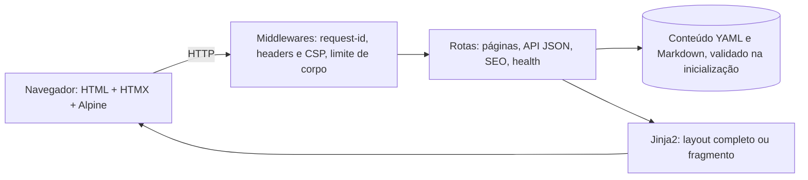

# Hub-currículo interativo

> Um currículo que **prova** o que diz: em vez de listar "FastAPI, asyncio, testes", este site é construído com essas tecnologias, e cada parte dele é uma demonstração de como eu desenvolvo software com Python.

Site-currículo bilíngue (pt-BR e en), renderizado no servidor com **FastAPI + Jinja2**, navegação fluida com **HTMX**, conteúdo em **YAML/Markdown validado por Pydantic**, API JSON pública, currículo em PDF e uma **política de segurança (CSP) estrita**: sem scripts inline e sem `eval`. **Não usa Node.js**: até o Tailwind CSS é compilado com um binário instalado pelo `pip`.

> **Status: v0.1**, fases F0 a F3 do [plano de implementação](PLANO_DE_IMPLEMENTACAO.md). As fases F4 a F9 (contato, livro de visitas, GitHub ao vivo, terminal web, playground Pyodide) estão no [roadmap](#roadmap) e **ainda não existem**.

## Sumário

- [Início rápido](#início-rápido)
- [Sobre o projeto](#sobre-o-projeto)
- [Stack tecnológica](#stack-tecnológica)
- [Passo a passo de execução](#passo-a-passo-de-execução)
- [Colocando o seu conteúdo](#colocando-o-seu-conteúdo)
- [Comandos úteis](#comandos-úteis)
- [Configuração](#configuração)
- [Contêiner](#contêiner)
- [Solução de problemas](#solução-de-problemas)
- [Estrutura do repositório](#estrutura-do-repositório)
- [Segurança](#segurança)
- [Roadmap](#roadmap)

## Início rápido

Com Python 3.11+ instalado, no PowerShell, dentro da pasta do projeto:

```powershell
python -m venv .venv
.\.venv\Scripts\Activate.ps1
pip install -r requirements.txt pytailwindcss==0.4.2
python -m app dev
```

Abra **http://127.0.0.1:8000**. Na primeira execução o comando baixa sozinho as bibliotecas de front-end (≈ 0,5 MB) e o binário do Tailwind (≈ 112 MB). Detalhes, Linux/macOS e variações no [passo a passo](#passo-a-passo-de-execução).

## Sobre o projeto

**Objetivo.** Servir como hub interativo de portfólio: quem avalia pode navegar, filtrar, ler estudos de caso, consultar a API, baixar o PDF e abrir o código, tudo com a qualidade verificável (testes, tipos estritos, CI).

**Princípios**

1. **Mostrar, não contar**: cada funcionalidade evidencia uma habilidade.
2. **Conteúdo primeiro**: tudo funciona sem JavaScript; o JS só melhora a experiência.
3. **Seguro por padrão**: CSP estrita, sem `eval`, sem execução de código do visitante no servidor.
4. **Conteúdo separado do código**: textos em `content/`, editáveis sem tocar no Python.
5. **Operação simples**: um processo, sem banco de dados nesta versão.

### O que já funciona (v0.1)

| Área | Detalhes |
|---|---|
| Páginas | Início, Experiência (filtro por tecnologia), Projetos e estudos de caso (busca e tags), Habilidades, Currículo imprimível, Sobre o site, páginas de erro localizadas |
| Idiomas | pt-BR e en, negociados por `Accept-Language` em `/`, com `hreflang` e sitemap |
| Navegação | HTMX troca só o título e o conteúdo; cabeçalho, menu e idioma são atualizados por *out-of-band swaps*; botão "voltar" restaura a página completa |
| Interface | Tema claro/escuro sem *flash*, menu móvel, *skip link*, foco e anúncio para leitores de tela após cada navegação |
| API | JSON somente leitura em `/api/v1/*` e explorador OpenAPI em `/api/docs` |
| Currículo | Versão para impressão e geração de PDF (pt/en) e de imagem Open Graph pela linha de comando |
| SEO | Canonical, Open Graph, JSON-LD, `robots.txt`, `sitemap.xml`, `security.txt` |
| Segurança | CSP por perfil, cabeçalhos de segurança, limite de corpo de requisição, assets verificados por SHA-384 |
| Qualidade | Testes unitários, de integração e de navegador; ruff; mypy estrito; djlint; pre-commit; CI com matriz Linux/Windows × Python 3.11–3.14 |

### Como as peças se encaixam



## Stack tecnológica

### Em uso hoje

| Camada | Tecnologia | Para que serve neste projeto |
|---|---|---|
| Linguagem | **Python 3.11+** (testado em 3.14) | Todo o back-end, a CLI e os testes |
| Web | **FastAPI** + **Uvicorn** | Servidor assíncrono, injeção de dependências, OpenAPI automática |
| Templates | **Jinja2** | Renderização no servidor; mesmo template serve a página completa ou só o fragmento HTMX |
| Interatividade | **HTMX** 2.0 + **Alpine.js** 3 (build CSP) | Navegação sem recarregar a página e pequenos comportamentos (menu, tema), sem `eval` |
| Estilo | **Tailwind CSS** v4 via `pytailwindcss` | CSS compilado por um binário instalado pelo `pip`, sem Node.js |
| Validação | **Pydantic** v2 + `pydantic-settings` | Modelos do conteúdo, respostas da API e configuração por variáveis `HUB_*` |
| Conteúdo | **PyYAML** (`safe_load`), `python-frontmatter`, **markdown-it-py**, **Pygments** | Conteúdo em YAML/Markdown, sem HTML cru, com código colorido |
| i18n | **Babel** (gettext) | Catálogos `.po` em pt-BR e en, plurais e datas localizadas |
| CLI | **Typer** + **Rich** | `python -m app …`: servidor, assets, conteúdo, traduções, exportação |
| Rede | **httpx2** | Download e verificação dos assets de front-end |
| Testes | **pytest** (+ asyncio, cov), **Playwright**, **hypothesis** | Unidade, integração e navegador real que falha em erro de console ou violação de CSP |
| Qualidade | **ruff**, **mypy** (strict), **djlint**, **pre-commit**, **pip-audit** | Lint, formatação, tipos, templates e vulnerabilidades |
| Entrega | **Docker** multi-stage, **GitHub Actions**, **Dependabot** | Imagem não-root, pipeline em matriz, atualizações semanais |

Assets de front-end (htmx, Alpine CSP, xterm.js) são **hospedados por nós** e conferidos por SHA-384 em [assets.lock.json](assets.lock.json). Não há CDN em tempo de execução.

### Já declaradas, ainda sem uso (fases futuras)

Estão no `requirements.txt` para travar as versões, mas **nenhum código as usa na v0.1**:

| Dependência | Fase | Uso previsto |
|---|---|---|
| `SQLAlchemy[asyncio]`, `aiosqlite`, `alembic` | F4 | Livro de visitas, endossos e contato em SQLite |
| `limits`, `python-multipart` | F4 | Rate limit e formulários |
| `cachetools` | F5 | Cache de respostas da API do GitHub |
| `plotly` | F5 | Gráficos (hoje só o `plotly.min.js` do pacote é copiado para os assets) |
| `jinja2-fragments` | n/d | Hoje o fragmento HTMX é feito com ``; pode ser removida |

## Passo a passo de execução

> **Testado em:** Windows 11 + PowerShell + Python 3.14, partindo de um clone limpo do repositório. Os comandos de Linux/macOS abaixo seguem a mesma lógica (só muda a ativação do ambiente virtual), mas **não foram executados nesses sistemas**; o CI do projeto cobre Linux assim que for publicado.

### Pré-requisitos

| Item | Obrigatório? | Observação |
|---|---|---|
| **Python 3.11 ou superior** | Sim | Confira com `python --version` |
| **Git** | Sim, para clonar | |
| Conexão com a internet | Sim, na 1ª execução | Baixa as bibliotecas de front-end e o binário do Tailwind |
| ≈ 400 MB livres em disco | Sim | O binário do Tailwind tem ≈ 112 MB |
| Docker Desktop | Não | Só para a [opção de contêiner](#contêiner); precisa estar aberto |

### 1. Obtenha o código

```powershell
git clone <URL-DO-REPOSITÓRIO> hub-curriculo
cd hub-curriculo
```

### 2. Crie e ative o ambiente virtual

```powershell
python -m venv .venv
.\.venv\Scripts\Activate.ps1
```

```bash
# Linux / macOS
python3 -m venv .venv
source .venv/bin/activate
```

Se o PowerShell bloquear o script de ativação, libere só para esta janela: `Set-ExecutionPolicy -Scope Process -ExecutionPolicy Bypass`.

### 3. Instale as dependências (escolha uma opção)

**Opção A: só quero rodar o site** (≈ 1 minuto)

```powershell
python -m pip install -U pip
pip install -r requirements.txt pytailwindcss==0.4.2
```

**Opção B: quero desenvolver, testar e gerar o PDF** (inclui pytest, ruff, mypy, Playwright…)

```powershell
python -m pip install -U pip
pip install -r requirements-dev.txt
playwright install chromium        # navegador usado pelos testes E2E e pelo PDF
```

Se o `pip` falhar com `ConnectionResetError` ao baixar o Playwright (≈ 39 MB), repita com `pip install --retries 10 --timeout 120 -r requirements-dev.txt`.

### 4. Inicie o servidor de desenvolvimento

```powershell
python -m app dev
```

O que acontece na **primeira** execução, automaticamente:

1. baixa htmx, Alpine (build CSP) e xterm para `app/web/static/vendor/`, conferindo o SHA-384;
2. baixa o binário do Tailwind v4.3.3 (≈ 112 MB, uma única vez) e compila o CSS com *fingerprint*;
3. sobe o servidor com recarga automática e recompilação do CSS ao salvar.

Nas execuções seguintes o início é imediato. Para parar, pressione **Ctrl+C**.

Opções: `--port 8001` (outra porta), `--host 0.0.0.0` (acessível na rede local), `--no-build` (pula a compilação dos assets).

### 5. Abra no navegador

Acesse **http://127.0.0.1:8000**. A raiz redireciona para `/pt/` ou `/en/` conforme o idioma do navegador.

| Endereço | O que é |
|---|---|
| `/pt/` · `/en/` | Início |
| `/pt/experience` | Experiência, com filtro por tecnologia |
| `/pt/projects` | Projetos (busca e tags) e `/pt/projects/<slug>` para o estudo de caso |
| `/pt/skills` | Habilidades |
| `/pt/resume` | Currículo imprimível |
| `/pt/about-site` | Sobre o site |
| `/api/docs` | Explorador da API (Swagger UI) |
| `/api/v1/profile`, `/skills`, `/experience`, `/projects` | API JSON (aceita `?lang=pt\|en`) |
| `/healthz` · `/readyz` | Verificação de saúde |

Confira por linha de comando: `curl http://127.0.0.1:8000/healthz` deve responder `{"status":"ok",…}`.

### 6. Coloque o seu conteúdo

Hoje todo o texto é **fictício** (há uma faixa amarela no topo avisando). Veja [Colocando o seu conteúdo](#colocando-o-seu-conteúdo).

### 7. (Opcional) Gere o PDF e a imagem de compartilhamento

Requer a **Opção B** (Playwright + Chromium):

```powershell
python -m app export all
```

Cria `build/downloads/resume.pt.pdf`, `resume.en.pdf` e `og.png`. Com os arquivos presentes, o botão **Baixar PDF** aparece na página do currículo, sem reiniciar o servidor.

### 8. (Opcional) Rode em modo produção local

```powershell
python -m app assets build     # o servidor de produção não compila assets
python -m app serve            # 1 worker, http://127.0.0.1:8000
```

Com `HUB_ENV=prod` a aplicação exige `HUB_SECRET_KEY` (≥ 32 caracteres) e **recusa subir com o conteúdo de exemplo**, a menos que `HUB_ALLOW_SAMPLE_CONTENT=true`. Gere uma chave com:

```powershell
python -c "import secrets; print(secrets.token_urlsafe(48))"
```

## Colocando o seu conteúdo

Todo o texto está em `content/` e hoje é **fictício** (`sample: true`). Edite:

| Arquivo | O que é |
|---|---|
| `content/<pt\|en>/profile.yaml` | Nome, headline, resumo, contato e links |
| `content/<pt\|en>/experience.yaml` | Experiências (use números nos resultados) |
| `content/<pt\|en>/skills.yaml` | Habilidades: nível 1–5, anos, evidências (slugs de projetos) |
| `content/<pt\|en>/education.yaml` | Formação |
| `content/<pt\|en>/projects/<slug>.md` | Estudos de caso (front matter YAML + Markdown) |

Cada arquivo existe nos **dois** idiomas. Depois de editar, valide (referências cruzadas, datas, URLs e **paridade pt/en**) e remova `sample: true` do `profile.yaml` de ambos:

```powershell
python -m app content validate            # lista todos os problemas de uma vez
python -m app content validate --strict   # também falha enquanto houver conteúdo de exemplo
```

O servidor em modo `dev` recarrega sozinho quando você salva um arquivo de `content/`.

## Comandos úteis

```powershell
python -m app --help
python -m app dev                    # desenvolvimento, com recarga e recompilação do CSS
python -m app serve                  # produção (1 worker)
python -m app assets sync            # baixa htmx, Alpine (build CSP) e xterm; confere os SHA-384
python -m app assets build           # Tailwind + fingerprint + manifest
python -m app content validate       # valida o conteúdo
python -m app i18n update            # extrai strings e atualiza os catálogos .po
python -m app i18n check             # falha se algo estiver sem tradução
python -m app export all             # PDFs do currículo e imagem Open Graph
```

**Testes e qualidade** (precisam da Opção B):

```powershell
pytest                               # unitários + integração (cobertura mínima: 85%)
pytest -m e2e tests/e2e              # navegador real; falha em erro de console ou violação de CSP
ruff check . ; ruff format --check . ; djlint app/web/templates --check ; mypy
pre-commit install                   # roda os mesmos checks a cada commit
```

## Configuração

Variáveis de ambiente com prefixo `HUB_` (ou um arquivo `.env`; veja [.env.example](.env.example)). As principais:

| Variável | Padrão | Uso |
|---|---|---|
| `HUB_ENV` | `dev` | `dev`, `test` ou `prod` |
| `HUB_SECRET_KEY` | chave de desenvolvimento | **Obrigatória em prod** (≥ 32 caracteres) |
| `HUB_SITE_URL` | `http://127.0.0.1:8000` | URL pública (canonical, Open Graph, sitemap) |
| `HUB_DEFAULT_LOCALE` | `pt` | Idioma padrão |
| `HUB_CONTENT_DIR` | `content` | Pasta do conteúdo |
| `HUB_DOWNLOADS_DIR` | `build/downloads` | Onde ficam os PDFs e a imagem OG |
| `HUB_ALLOW_SAMPLE_CONTENT` | `false` | Permite subir em prod com o conteúdo de exemplo |
| `HUB_TRUSTED_PROXIES` | `127.0.0.1` | IPs do proxy reverso confiáveis para `X-Forwarded-*` |
| `HUB_HSTS_MAX_AGE` | `0` (desligado) | Segundos de HSTS; ative só depois de validar o HTTPS |
| `HUB_LOG_LEVEL` · `HUB_LOG_FORMAT` | `INFO` · `rich` (dev) / `json` (prod) | Logs |

## Contêiner

> **Ainda não foi construída nem testada**: o `Dockerfile` e o `compose.yaml` foram escritos, mas o Docker Desktop não estava ativo durante o desenvolvimento. Trate como ponto de partida.

```powershell
copy .env.example .env      # defina HUB_SECRET_KEY (≥ 32 caracteres)
docker compose up --build   # http://localhost:8000
```

A imagem é multi-stage (o binário do Tailwind fica só no estágio de build), roda como usuário não-root e tem `HEALTHCHECK` em `/healthz`. O `compose.yaml` já define `HUB_ALLOW_SAMPLE_CONTENT=true` para você poder testar com o conteúdo de exemplo. Use **uma única instância**: no futuro o rate limit e os caches ficarão em memória e o SQLite, no volume `/data`.

## Solução de problemas

| Sintoma | Causa provável e solução |
|---|---|
| `Activate.ps1` não pode ser carregado | Política de execução do PowerShell: `Set-ExecutionPolicy -Scope Process -ExecutionPolicy Bypass` |
| `ConnectionResetError` ao instalar | Download grande interrompido: repita com `pip install --retries 10 --timeout 120 …` |
| Site sem estilo (texto "cru") | Os assets não foram compilados: `python -m app assets build` |
| `Address already in use` / porta ocupada | Use outra porta: `python -m app dev --port 8001` |
| `ContentError` ao iniciar | O conteúdo tem erro: `python -m app content validate` lista todos os problemas |
| Em prod: "HUB_SECRET_KEY must be set…" | Defina a chave (≥ 32 caracteres), veja o [passo 8](#8-opcional-rode-em-modo-produção-local) |
| Em prod: "Sample content is active" | Troque o conteúdo de exemplo ou use `HUB_ALLOW_SAMPLE_CONTENT=true` só para testar |
| `python -m app export` falha | Falta o Chromium: use a Opção B e `playwright install chromium` |
| Mudança não aparece no `dev` (Windows) | O *hot reload* do uvicorn às vezes deixa de reiniciar após várias mudanças seguidas (acontece também com `uvicorn --reload` puro). Pare com `Ctrl+C` e rode `python -m app dev` de novo |
| Botão "Baixar PDF" não aparece | Os PDFs ainda não existem: `python -m app export all` |

## Estrutura do repositório

```text
app/
  main.py            fábrica da aplicação (create_app)
  core/              configuração, logging, middlewares, CSP, i18n, templates, erros
  content/           modelos Pydantic, loader/validador, Markdown, store em memória
  routers/           páginas, API JSON, SEO, health
  cli/               comandos: dev, serve, assets, content, i18n, export
  locales/           catálogos de tradução (pt_BR e en)
  web/
    templates/       base, fragmento, páginas, componentes, erros
    static/          css/, js/, img/ (e vendor/, dist/ gerados)
content/             conteúdo do currículo (pt/ e en/) e, no futuro, demos/
tests/               unit/, integration/ e e2e/
assets.lock.json     versões e SHA-384 dos assets vendorizados
PLANO_DE_IMPLEMENTACAO.md   decisões, fases e riscos
```

## Segurança

- **CSP estrita por padrão**: `script-src 'self'`, `style-src 'self'`, sem `unsafe-eval`. Alpine.js usa o **build CSP** e o htmx roda com `allowEval=false`.
- **Perfis de CSP por rota** para bibliotecas que injetam `<style>` (gráficos e terminal, nas próximas fases); ver `app/core/security.py`.
- **Cadeia de suprimentos**: assets de terceiros hospedados por nós e verificados por SHA-384; Swagger UI com SRI; dependências com versão fixa e `pip-audit` no CI.
- **Entrada**: Markdown sem HTML cru, YAML sempre com `safe_load`, corpo de requisição limitado a 16 KB, saída HTML com *autoescape*.
- **Produção**: recusa subir sem chave secreta real nem com conteúdo de exemplo; `robots.txt` bloqueia a indexação enquanto o conteúdo for de exemplo.

## Roadmap

| Fase | Entrega | Situação |
|---|---|---|
| F0–F3 | Base, núcleo web, conteúdo e páginas, entrega (v0.1) | ✅ concluída |
| F4 | Contato, livro de visitas e endossos de skills (SQLite) | pendente |
| F5 | Dados ao vivo do GitHub e gráficos Plotly | pendente |
| F6 | Terminal web (xterm.js + WebSocket) | pendente |
| F7 | Playground Python no navegador (Pyodide) | pendente |
| F8–F9 | Hardening, acessibilidade/performance e lançamento | pendente |

Detalhes, decisões e riscos em [PLANO_DE_IMPLEMENTACAO.md](PLANO_DE_IMPLEMENTACAO.md). Histórico de mudanças em [CHANGELOG.md](CHANGELOG.md).

## Licença

[MIT](LICENSE)
